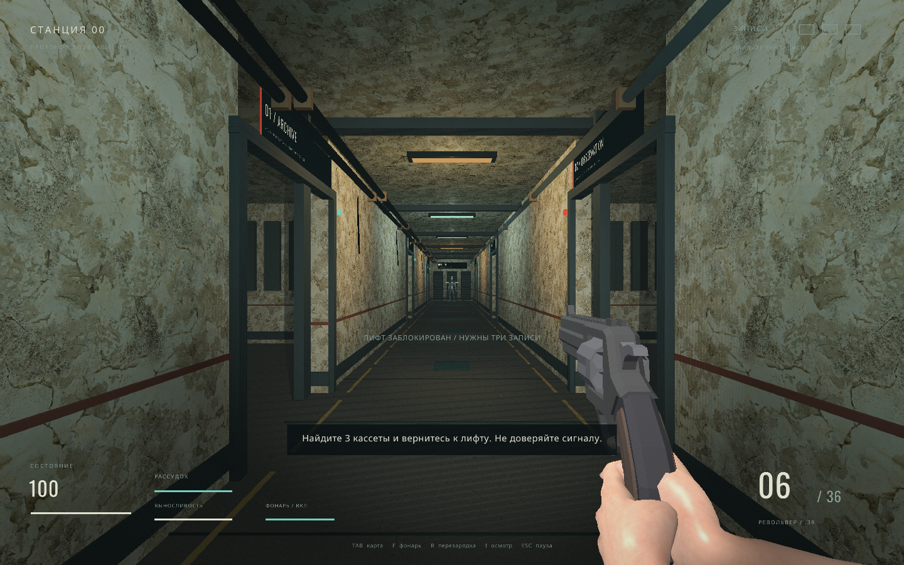

# NULL FREQUENCY

**Трёхмерный психологический хоррор от первого лица с револьвером.**

Вы приходите в себя у лифта в заброшенном исследовательском комплексе.
Радио ловит сигнал, которого здесь не должно быть. Найдите три кассеты с
воспоминаниями в боковых комнатах и вернитесь к лифту. В коридорах есть то,
что можно остановить пулей, и то, на что опасно просто смотреть.



[Демонстрация ходьбы, перезарядки и осмотра оружия](docs/weapon-animation.mp4)

Это законченный небольшой игровой прототип на **C++17 и raylib 5.5**:
одна локация, цель, враги, победа и поражение. Используются готовые модели
Quaternius, Poly Haven и para, текстуры бетона и скелетная анимация персонажей.
Звук и эффекты создаются программно. Интерфейс и сюжет — на русском языке.

- Револьвер .38 на шесть патронов: прицеливание, отдача и осмотр оружия.
- Скелетные руки с хватом и движением пальцев; покачивание при ходьбе,
  положение при беге и дыхание. Перезарядка с открытием барабана,
  выбросом гильз, подачей патронов и возвращением в хват.
- Фонарик с батареей, бег с запасом сил, здоровье и рассудок.
- Преследующие существа, видения, мерцающий свет и пространственный звук.
- Кассеты, припасы, карта комплекса и режим уменьшенных эффектов.
- Тени от фонаря с картой глубины 2048 × 2048 и фильтрацией PCF,
  карты нормалей бетона и предметов, туман и плёночные эффекты.
- Импортированные 3D-модели оружия и предметов; противники с 53 костями
  и анимациями ходьбы, атаки и смерти.

## Играть

Скачайте архив для своей ОС из раздела **Releases**, распакуйте целиком,
сохранив папку `assets` рядом с игрой.

- **Linux x86_64:** запустите `./run.sh` из папки архива. При необходимости:
  `chmod +x run.sh null-frequency`.
- **Windows x64:** запустите `null-frequency.exe`.

Нужны видеодрайвер с **OpenGL 3.3** и мышь. Linux-сборка использует X11;
в сеансе Wayland нужен XWayland. Для атмосферы рекомендуются наушники.
Если изображение слишком интенсивное, нажмите **V** для уменьшения эффектов.

| Действие | Управление |
| --- | --- |
| Движение | WASD |
| Смотреть | Мышь |
| Стрелять | Левая кнопка мыши |
| Прицелиться | Правая кнопка мыши, удерживать |
| Перезарядить | R |
| Осмотреть оружие | I |
| Бежать | Shift |
| Фонарик | F |
| Взять предмет / использовать лифт | E |
| Карта | Tab, удерживать |
| Уменьшить эффекты | V |
| Выключить / включить звук | M |
| Полный экран | F11 |
| Пауза | Esc |

## Собрать на Linux без CMake

Нужны `g++` с поддержкой C++17, `make`, `curl`, `tar`, `sha256sum`,
заголовки OpenGL и библиотеки разработки X11. Зависимость raylib скачивается
автоматически в `.deps` с проверкой SHA-256; глобальная установка не нужна.

Ubuntu / Debian:

```sh
sudo apt-get install build-essential curl libgl1-mesa-dev libx11-dev \
  libxrandr-dev libxi-dev libxcursor-dev libxinerama-dev
./scripts/build.sh
./run.sh
```

Arch Linux:

```sh
sudo pacman -S --needed base-devel curl mesa libx11 libxrandr libxi libxcursor libxinerama
./scripts/build.sh
./run.sh
```

Скрипт собирает `build/null-frequency` и копирует ресурсы в `build/assets`.
`make`, `make test`, `make run` и `make package` предоставляют те же действия.
Число параллельных задач можно задать через `JOBS=4 ./scripts/build.sh`.

## Собрать с CMake

Нужны CMake 3.18+, компилятор C++17 и интернет при первой конфигурации.
На Linux также нужны перечисленные выше библиотеки разработки.

```sh
cmake -S . -B build -DCMAKE_BUILD_TYPE=Release
cmake --build build --config Release --parallel
ctest --test-dir build -C Release --output-on-failure
```

На Linux запускайте `./run.sh`. На Windows используйте Visual Studio 2022
с компонентом **Desktop development with C++**, затем запустите
`build/Release/null-frequency.exe`. Ресурсы копируются к исполняемому файлу
при сборке; рабочей папкой должна быть папка с исполняемым файлом.

Проверки игровой логики не требуют графики и raylib:

```sh
make test
# Или через CMake, без загрузки raylib:
cmake -S . -B build-tests -DBUILD_GAME=OFF
cmake --build build-tests --parallel
ctest --test-dir build-tests --output-on-failure
```

## Пакет и автоматические сборки

```sh
make package
```

Linux-пакет появляется в `dist/null-frequency-linux-x86_64.tar.gz`.
В него входят исполняемый файл, ресурсы, документация и лицензии.
Для GNU C++ runtime используются статические библиотеки; системные glibc,
OpenGL и X11 по-прежнему нужны. Локальный пакет требует совместимую с
машиной сборки версию glibc. GitHub Actions собирает Linux на Ubuntu 22.04
и Windows x64, запускает проверки и публикует архивы при теге `v*`.

## Модели и Blender

Для запуска и сборки игры Blender не нужен. Готовые модели лежат в `assets`,
а редактируемые исходники рук в формате `.blend`, исходные FBX и скрипт
экспорта сохранены в [`art/hands-source`](art/hands-source/SOURCE.md).
Они остаются в репозитории и не входят в игровые архивы.

Анимация оружия и рук задаётся в `src/weapon_view.hpp`: руки используют
скелет и обратную кинематику, а барабан и спусковой крючок двигаются отдельно.
Происхождение ресурсов и полные лицензии записаны в [THIRD_PARTY.md](THIRD_PARTY.md)
и файлах `SOURCE.md` рядом с моделями.

## English

**NULL FREQUENCY** is a small C++17 / raylib 5.5 first-person psychological
horror shooter. Recover three memory tapes, survive the facility and return
to the elevator. It features a six-shot revolver, a battery-powered flashlight,
hostile entities, sanity effects and a procedural soundscape. The game UI is
in Russian. Download a release or build with CMake; Linux also supports
`./scripts/build.sh` without CMake.

Game code: [MIT](LICENSE). Dependencies and fonts: [THIRD_PARTY.md](THIRD_PARTY.md).
